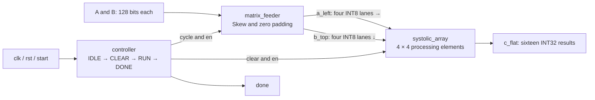

# TinyNPU — 4 × 4 Systolic Matrix Multiplication in SystemVerilog

TinyNPU is a personal electronic engineering portfolio project exploring the hardware behind matrix multiplication accelerators. It implements a fixed-size, output-stationary **4 × 4 systolic array** with 16 processing elements, a matrix feeder, and a finite-state controller.

The project demonstrates RTL hierarchy, signed multiply–accumulate arithmetic, spatial data reuse, cycle scheduling, and testbench-based functional verification. It is intended for academic discussion and postgraduate electronic engineering project presentations.

**Status:** RTL implementation and functional simulation completed; the previous verification session was reported as all PASS. Existing Icarus Verilog waveform files are preserved as evidence. This documentation release does not rerun the simulations. See [verification scope and evidence](docs/verification.md).

## Design at a glance

| Property | Implementation |
|---|---|
| Operation | `C = A × B`, two fixed 4 × 4 matrices |
| Compute array | 16 PEs, arranged as 4 rows × 4 columns |
| Operand format | Signed 8-bit two's-complement integers |
| PE arithmetic | Signed 16-bit product, sign-extended into a 32-bit accumulator |
| Input interface | Two 128-bit packed matrices |
| Output interface | Sixteen 32-bit results packed into `c_flat[511:0]` |
| Scheduling | One CLEAR state, then 10 enabled RUN cycles (`cycle = 0…9`) |
| Control | Synchronous active-high reset; `start` request; one-cycle `done` |

The 10 ns clocks in the testbenches are simulation stimulus, not a measured hardware clock limit. FPGA deployment, synthesis area/timing, power measurements, ASIC implementation, and tape-out have not been demonstrated.

## Architecture



All three blocks are integrated by [`tiny_npu_top`](rtl/tiny_npu_top.sv); `clk` and `rst` reach the clocked controller and array.

| Block | Source | Responsibility |
|---|---|---|
| Processing Element | [pe.sv](rtl/pe.sv) | Computes `acc ← acc + a_in × b_in`; registers A to the right and B downward on each enabled edge. Reset or clear zeros all three registers; disabling holds them. |
| Systolic Array | [systolic.sv](rtl/systolic.sv) | Uses nested generate loops to instantiate 16 PEs. Each PE retains one output element locally. |
| Controller | [controller.sv](rtl/controller.sv) | Sequences IDLE, CLEAR, RUN and DONE; supplies the feeder cycle and array controls. |
| Matrix Feeder | [matrix_feeder.sv](rtl/matrix_feeder.sv) | Combinationally selects four A row lanes and four B column lanes, inserting the required skew and padding zeros. |
| Top level | [tiny_npu_top.sv](rtl/tiny_npu_top.sv) | Connects the packed matrix interface to the feeder, controller and compute array. |

## Matrix multiplication dataflow

For zero-based row `r`, column `c` and inner index `k`:

```text
C[r,c] = Σ A[r,k] × B[k,c],  k = 0…3

At RUN cycle t:
  left lane r = A[r,t-r]    if 0 ≤ t-r < 4, otherwise 0
  top lane c  = B[t-c,c]    if 0 ≤ t-c < 4, otherwise 0

Inside the array:
  A travels right → one PE per enabled clock edge
  B travels down  ↓ one PE per enabled clock edge
  C stays in its PE accumulator (output-stationary)
```

The matching operands for term `k` meet at PE `[r,c]` on RUN edge `t = r + c + k`. The final term reaches PE `[3,3]` at `t = 9`, explaining the ten RUN cycles. Boundary inputs become zero while the last operands continue propagating through the array.

Example from the existing array and top-level testbenches:

```text
A = [ 1  2  3  4 ]    B = [ 1  0  2  0 ]    C = [  4   6   5   8 ]
    [ 5  6  7  8 ]        [ 0  1  0  2 ]        [ 12  14  17  20 ]
    [ 9 10 11 12 ]        [ 1  0  1  0 ]        [ 20  22  29  32 ]
    [13 14 15 16 ]        [ 0  1  0  1 ]        [ 28  30  41  44 ]
```

## Interface and use

Matrices use row-major packing with the first element in the least-significant bits:

```systemverilog
a_matrix[(r*4+c)*8 +: 8]   // A[r,c], signed INT8 bit pattern
b_matrix[(r*4+c)*8 +: 8]   // B[r,c], signed INT8 bit pattern
c_flat[(r*4+c)*32 +: 32]   // C[r,c]; use $signed(...) when interpreting it
```

Assert `rst` across a rising edge, then deassert it. Present the two matrices and pulse `start` for one clock while the controller is idle. Hold the matrices stable until `done`: the feeder reads the input ports directly and there are no input matrix registers. Sample results when `done` is high. They remain stored until reset or the next CLEAR.

`start` is accepted only in IDLE; there is no busy/ready port or request queue. A continuously asserted `start` can launch another operation after the controller returns to IDLE. The controller enters CLEAR on the accepting edge, RUN on the next edge, and asserts `done` after the tenth RUN sampling edge (11 clock periods after acceptance).

## Verification and simulation material

Five testbenches cover the PE, array, controller, feeder and integrated top level. The array and top-level benches compare all 16 output elements against a software-style reference calculation. The feeder bench prints its schedule and checks disabled outputs; it does not automatically compare every active lane.

- [Verification report](docs/verification.md): test scope, evidence provenance and limitations.
- [Archived waveforms](results/waveforms/): byte-for-byte copies of the existing VCD files.
- [Waveform-derived result](results/top_waveform_summary.md): values extracted from the archived top-level VCD, with a source hash.
- [Original interactive dataflow demonstration](TinyNPU_AB_4x4_Interactive.html): download and open locally; an educational animation, not a simulator trace.
- [Original demonstration video](TinyNPU_dataflow_demo.mp4).

### Optional reproduction

Requires Icarus Verilog (`iverilog`, `vvp`) on PATH. From the repository root:

```powershell
# Keep rerun outputs separate from the archived evidence.
New-Item -ItemType Directory -Force build/sim | Out-Null
iverilog -g2012 -s tb_tiny_npu_top -o build/top.vvp rtl/pe.sv rtl/systolic.sv rtl/controller.sv rtl/matrix_feeder.sv rtl/tiny_npu_top.sv tb/tb_tiny_npu_top.sv
Push-Location build
vvp top.vvp
Pop-Location
```

The testbench writes `sim/tiny_npu_top.vcd` relative to its working directory, so this command produces `build/sim/tiny_npu_top.vcd`. Expected success text is `ALL TINYNPU TOP TESTS PASSED`; that string is a testbench expectation, not a newly captured log. Optional waveform viewing: `gtkwave results/waveforms/tiny_npu_top.vcd`.

## Repository guide

```text
rtl/                      Original SystemVerilog design modules
tb/                       Original five testbenches
sim/                      Original local simulation artifacts (ignored)
results/waveforms/        Curated copies of real VCD evidence
results/                  Waveform extraction summary
docs/                     Verification, publication notes and original learning material
docs/archive/             Preserved original README versions
scripts/                  Reproducible extraction of saved waveform evidence
build/                    Optional rerun outputs (ignored)
```

The original learning notes and images are indexed in [the material guide](docs/materials.md). Some original notes are in Chinese. They are retained as development history; this README and the verification report are the primary English presentation documents.

## Scope and next steps

Completed: modular RTL, signed MAC datapath, fixed 4 × 4 spatial array, skewed matrix feeding, finite-state sequencing, integration, directed testbenches and saved simulation traces.

Potential extensions: automated signed-boundary and randomized tests, reset/restart sequences, a fully self-checking feeder bench, parameterized dimensions, a buffered streaming interface, and synthesis/FPGA evaluation. These are future work, not completed results. TinyNPU currently implements a matrix multiplication kernel rather than a programmable neural-network processor.

## License

The existing upstream repository uses the [MIT License](LICENSE), copyright 2026 QueenMary-2. Its license and initial commit are retained in the prepared publication checkout. See [publication notes](docs/publication_notes.md) for the local Git arrangement.
