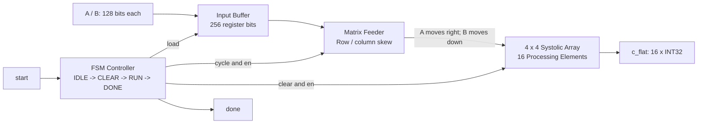

# TinyNPU - Buffered INT8 Systolic Matrix Accelerator

TinyNPU is a SystemVerilog matrix multiplication accelerator prototype for studying RTL design, spatial dataflow and hardware verification. A **4 x 4 output-stationary systolic array** computes `C = A * B` using 16 signed INT8 multiply-accumulate processing elements and 32-bit local accumulators.

It provides a concrete portfolio example for RTL / ASIC design and AI accelerator engineering: modular hardware, explicit cycle scheduling, input buffering, executable reference comparisons and reproducible generic synthesis. It is an educational and research prototype, not a commercial or programmable NPU.

## Confirmed engineering results

Verified on **29 October 2026** with the existing OSS CAD Suite installation:

| Item | Confirmed result |
|---|---|
| Extended top-level verification | **24 / 24 matrix tests passed; 0 errors** |
| Output checks in the extended suite | **384 comparisons** (24 matrices x 16 elements) |
| Directed cases | Zero, Identity, Negative, alternating INT8 Boundary |
| Random cases | 20 signed INT8 matrix pairs |
| Other regressions | PE, array, controller, feeder, input buffer and directed top-level benches passed |
| Yosys generic synthesis | **10,724 cells; 1,032 flip-flop bits** |
| Structural checks | `check -assert` completed; 0 reported problems |

[Captured logs, VCDs and source hashes](results/runs/2026-10-29/README.md) support these results. [Verification details](docs/verification.md) explain coverage and limitations. Cell counts are generic logic counts, not standard-cell area, PPA or FPGA utilization.

## Architecture



Synchronous active-high `rst` resets the clocked modules. Six RTL modules implement the design:

| Module | Implementation and responsibility |
|---|---|
| [tiny_npu_top](rtl/tiny_npu_top.sv) | Integrates controller, buffer, feeder and array; exposes packed matrix ports, `start` and `done`. |
| [input_buffer](rtl/input_buffer.sv) | Captures two 128-bit matrices on a rising edge with `load=1`; holds them throughout computation. Registers, not SRAM. |
| [controller](rtl/controller.sv) | Generates `load`, `clear`, `en` and a four-bit cycle count through IDLE, CLEAR, RUN and DONE. |
| [matrix_feeder](rtl/matrix_feeder.sv) | Combinationally selects four A row lanes and four B column lanes with cycle-dependent skew and zero padding. |
| [systolic_array](rtl/systolic.sv) | Nested generate loops instantiate 16 PEs with registered horizontal A and vertical B links. Each PE owns one output element. |
| [pe](rtl/pe.sv) | Signed 8 x 8 multiplication, 16-bit product, explicit sign extension and 32-bit accumulation. Forwards operands when enabled; reset/clear zeros state; disabling holds state. |

[Architecture and interface details](docs/architecture.md) describe timing. An [existing PE structure drawing](docs/diagrams/pe_structure.svg) is preserved as supporting material; its original generation command/source revision was not recorded.

## Cycle-by-cycle dataflow

For zero-based row `r`, column `c`, and inner index `k`:

```text
C[r,c] = sum_k A[r,k] * B[k,c], k = 0..3

RUN cycle t:
  left lane r = A[r,t-r]  when 0 <= t-r < 4; otherwise 0
  top lane c  = B[t-c,c]  when 0 <= t-c < 4; otherwise 0

A moves right, B moves down, one PE per enabled edge.
Matching operands meet at PE[r,c] on RUN edge t = r + c + k.
The partial sum stays inside that PE (output-stationary).
```

The last product reaches PE `[3,3]` at `t=9`. RUN therefore performs ten enabled sampling edges, including propagation after boundary lanes have returned to zero. This fixed schedule is an RTL cycle property, not a measured hardware frequency.

| FSM state | Control and operation |
|---|---|
| IDLE | Wait for `start`; no queued requests. |
| CLEAR | Assert `load` and `clear`. On the edge leaving CLEAR, capture A/B and zero PE registers. |
| RUN | Assert `en`; feeder reads buffered inputs; sample cycles 0 through 9. |
| DONE | Assert `done` for one cycle, then return to IDLE. |

If `start` is accepted on E0, matrices are captured on E1, compute edges are E2-E11, and `done` is high after E11. Hold external matrices stable through E1; they may change after capture. Input buffering is the principal datapath addition since the previous release, which used live input ports.

## RTL interface and design choices

| Signal / property | Format or behavior |
|---|---|
| `a_matrix`, `b_matrix` | Two row-major 128-bit inputs, 16 signed INT8 bit patterns each |
| `c_flat` | Row-major 512-bit output, 16 signed INT32 bit patterns |
| `clk`, `rst` | Rising-edge clock; synchronous active-high reset |
| `start` | Accepted in IDLE; pulse for one clock |
| `done` | One-cycle result-valid indication; results hold until clear/reset |
| Input storage | 256 flip-flop bits; one pair, no double buffering |
| Compute storage | 16 x (8-bit A + 8-bit B + 32-bit accumulator) = 768 register bits |

```systemverilog
a_matrix[(r*4+c)*8 +: 8]   // A[r,c]
b_matrix[(r*4+c)*8 +: 8]   // B[r,c]
$signed(c_flat[(r*4+c)*32 +: 32]) // C[r,c]
```

Packed ports carry bit patterns; signed interpretation occurs in the PE and result checks. Local accumulators avoid moving partial sums between PEs. Fixed dimensions and RUN length keep control simple. There is no busy/ready interface: requests during CLEAR/RUN/DONE are not accepted; holding `start` high can launch another operation after return to IDLE.

## Functional verification

The [extended bench](tb/tb_tiny_npu_extended.sv) calculates a reference dot product using signed input slices, waits for `done` with a 20-cycle bound, and compares all 16 outputs. It runs four fixed matrix pairs followed by twenty `$urandom_range(0,255)-128` pairs. The captured run confirms **24 PASS markers, 384 output comparisons and zero errors**.

Seven existing benches were run without editing their test logic. The buffer bench checks reset, load, hold while external values change, and a second load. The feeder bench prints its active schedule and asserts disabled outputs; active lanes are not individually self-checked. The controller bench checks state outputs and RUN length but does not directly assert the added `load` output. Integrated tests hold matrix inputs stable during RUN, so adversarial top-level input changes after capture remain a coverage gap.

The runner checks process status and success/failure text: the extended and buffer benches print failure summaries without necessarily exiting nonzero. The existing bench does not explicitly seed its RNG; the saved VCD captures actual tested inputs. Cross-simulator random sequences are not guaranteed to match. This is not exhaustive, formal or coverage-driven verification.

## Generic synthesis

[The Yosys script](scripts/synth.ys) reads the original SystemVerilog, checks hierarchy, runs `synth -top tiny_npu_top`, then `check -assert` and `stat`. No RTL conversion or functional rewrite is used.

| Tool / statistic | Observed result |
|---|---|
| Yosys | 0.69+270, git `c4a0a2c48` |
| Top | `tiny_npu_top` |
| Total cells including submodules | 10,724 |
| Enabled synchronous-reset flip-flops | 1,028 x `$_SDFFE_PP0P_` |
| Other flip-flops | 4 x `$_DFF_P_` |
| Total flip-flop bits | 1,032 (1,028 + 4) |
| Memories | 0 |

The 1,032 bits comprise 768 PE bits, 256 input-buffer bits and 8 controller bits in this mapping. The [full synthesis log](results/runs/2026-10-29/yosys_synth.log) retains diagnostics, including ABC combinational-network warnings. Structural checks complete with zero problems; this is not formal equivalence proof. No target Liberty library, timing constraints, FPGA device, placement, routing, STA or power flow is applied. Counts can change with tool versions/options.

## Reproduction

Requires Python 3, Icarus Verilog and Yosys on PATH; the runner uses only the Python standard library. The checked run used Icarus Verilog 14.0 (devel), `s20260301-541-gb25510638-dirty`, and Yosys as above from OSS CAD Suite 20261009. On Windows use the suite's configured shell with both `bin` and `lib` available.

From the repository root, choose a **new** output directory:

```powershell
# All seven benches plus synthesis. Existing output directories are refused.
python scripts/run_checks.py --output build/my-run

# Optional separate stages; each needs a different new directory.
python scripts/run_checks.py --mode sim --output build/my-sim
python scripts/run_checks.py --mode synth --output build/my-synth
```

Equivalent direct commands for the extended suite and synthesis:

```powershell
New-Item -ItemType Directory build/manual-run/sim | Out-Null
iverilog -g2012 -s tb_tiny_npu_extended -o build/manual-run/extended.vvp rtl/pe.sv rtl/systolic.sv rtl/input_buffer.sv rtl/controller.sv rtl/matrix_feeder.sv rtl/tiny_npu_top.sv tb/tb_tiny_npu_extended.sv
Push-Location build/manual-run
vvp extended.vvp
Pop-Location
yosys -s scripts/synth.ys
```

Use a new directory for the direct example too. Testbenches write VCDs relative to their working directory; the runner isolates them from original `sim/` and archived evidence. Its manifest records commands and source/artifact hashes. See [the evidence index](results/runs/2026-10-29/README.md).

## Repository structure

```text
rtl/                       Six SystemVerilog modules
tb/                        Seven testbenches
scripts/run_checks.py      Simulation / synthesis runner
scripts/synth.ys           Generic Yosys flow
results/runs/2026-10-29/    Logs, VCDs and source/artifact hashes
results/waveforms/          Preserved earlier VCD evidence
docs/                      Architecture, verification and original notes
docs/diagrams/              Existing PE structure SVG
docs/archive/               Earlier presentation documents
sim/                       Original local artifacts (ignored, retained locally)
build/                     Isolated rerun output (ignored)
```

The [material guide](docs/materials.md) indexes original notes, images, video and the [Chinese interactive illustration](TinyNPU_AB_4x4_Interactive.html). The illustration is conceptual, not a simulator trace.

## Limitations and future work

The kernel has fixed 4 x 4 dimensions, INT8 inputs, INT32 accumulators and a parallel packed interface. Input buffering uses registers, not SRAM. There is no SRAM subsystem, DMA, AXI bus, instruction set, configurable quantization, activation pipeline or full neural-network execution stack. No FPGA deployment, ASIC physical implementation, measured frequency, area, power or tape-out is claimed.

Future work includes banked on-chip SRAM and tiling/data reuse; streaming and DMA/AXI integration; scaling, rounding and saturation for quantization; configurable dimensions and compute modes; explicit random seeds, assertions and coverage; FPGA implementation; and technology-mapped synthesis, constrained STA and physical design for an ASIC target.

## License

[MIT License](LICENSE), copyright 2026 QueenMary-2. Existing Initial commit and subsequent project history are retained.
