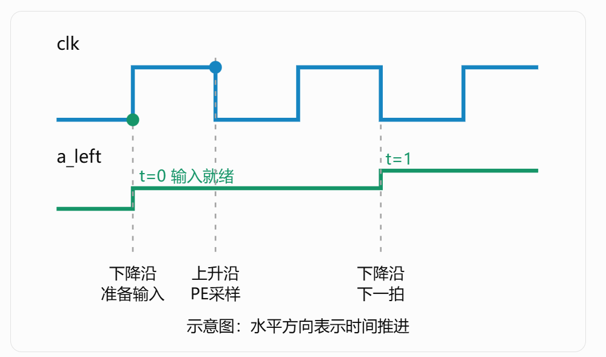
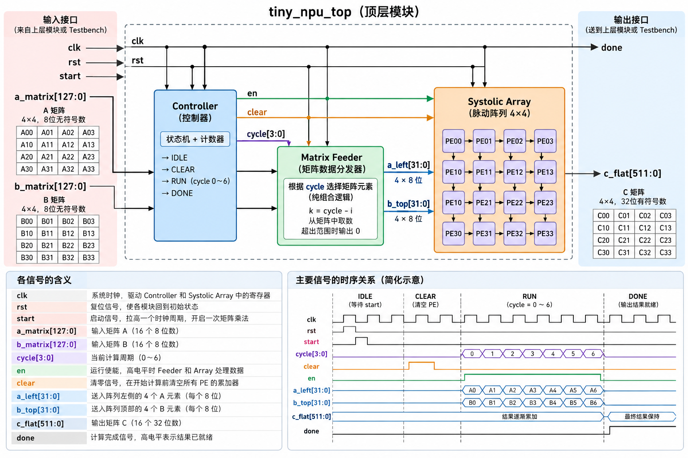

脉动阵列可视化运行流程（4*4）
脉动阵列输入输出流程（文字版）
数据类型，变量定义

genvar r;声明生成变量

for (r=0; r<4; r=r+1) begin:A_INPUT
    assign a_link[r][0] = a_left[r*8+:8];
end
r取0-3，在硬件设计工具生成电路结构时直接展开成四条平行的连接，而并非r从0-3依次经过一个时钟周期来运行。
generate：声明硬件生成区域，用循环来实例化多个重复的模块或者连接多个已经声明的连线

通过两个嵌套的for循环&generate函数实例化16个pe模块
如何做到A从左向右传播：将pe[0][0]的输入连接到a_link[0][0]，输出连接到a_link[0][1]。在下一个循环，实例化的模块变为pe[0][1]，将其输入连接到a_link[0][1]上

testbench中的错位输入：
//A矩阵的定义：
    for (i=0; i<4; i=i+1) begin
                for (j=0; j<4; j=j+1) begin
                    A[i][j] = i*4+j+1;
                    B[i][j] = 0;
                end
            end
    因此A矩阵为[1,2,3,4]
              [5,6,7,8]
              [9,10,11,12]
              [13,14,15,16]

//错位输入开始
for (t=0; t<10; t=t+1) begin

            @(negedge clk);

            a_left = 0;
            b_top = 0;

            // A的第i行延迟i拍输入
            for (i=0; i<4; i=i+1) begin
                if ((t>=i) && (t-i<4))
                    a_left[i*8 +: 8] = A[i][t-i];
            end
    t=0：
    i=0：满足判断条件，a_left=A[0][0]=1
    i=1-4：不满足。
    输入为[1000]
    而至于为何在1产生时不是直接进入阵列计算，而是等待[1000]全部产生之后再进入阵列，见图：：没有在语句中定义#delay，所以这几行赋值语句按顺序执行，消耗实际时间，但并不推进仿真时间。
    
    t=1：
    i=2-4：不满足条件
    输入为[2500]

    matrix_feeder部分：______________________________________________________________________

        if (en) begin
            for (int i = 0; i < 4; i++) begin
                k = int'(cycle) - i;

                if (k >= 0 && k < 4)
                    a_left[i*8 +: 8] =
                        a_matrix[(i*4+k)*8 +: 8];
            end
        这个for循环的意思是经过综合后得出四条平行的电路，并非逐行运行。
        同时，将cycle，i接入这四条电路里。
        从for循环开始到end以及其他延迟加起来的总时间需要小于cycle变化的时间（一个时钟周期）：(matrix_fed.png)

    顶层模块_________________________________________________________________________________
    模块连接图